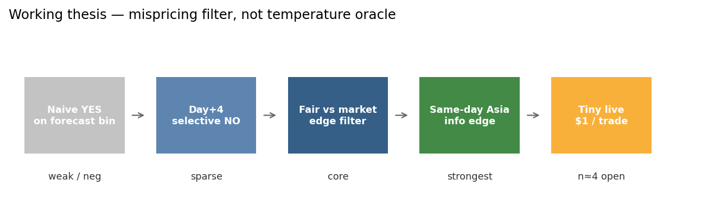
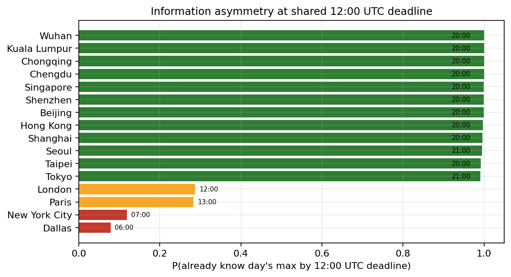
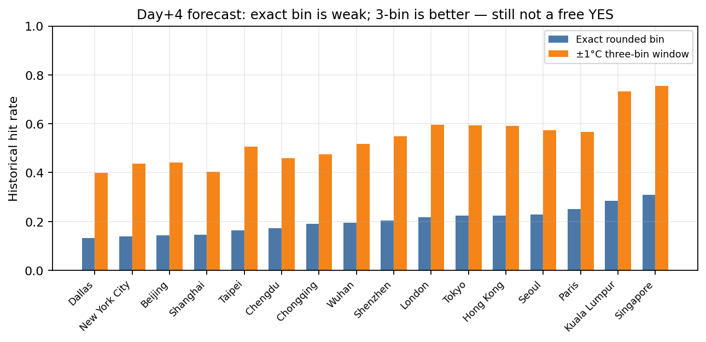
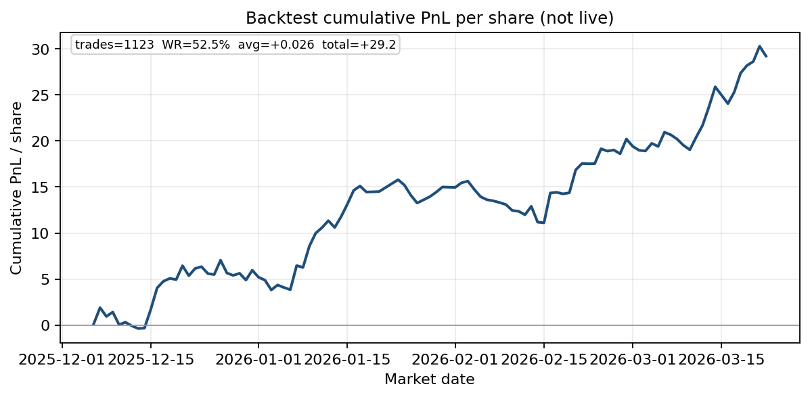
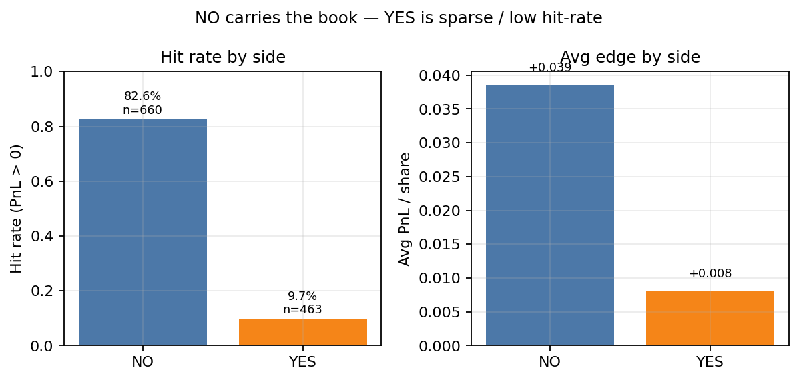
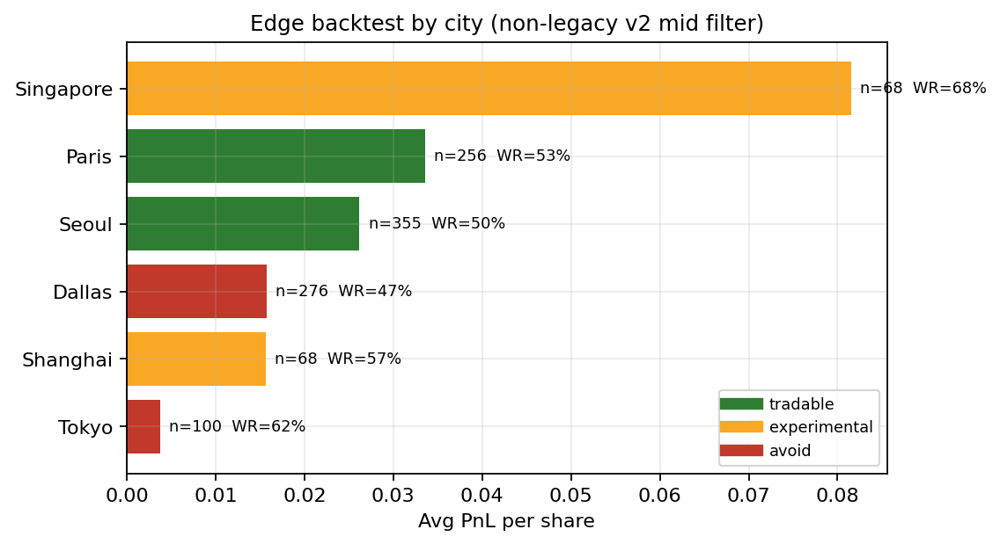
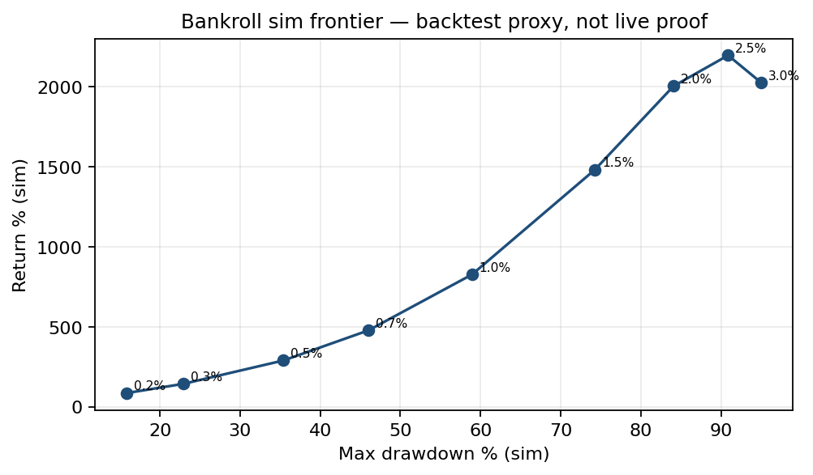

# Research Note: Polymarket Weather Markets — Selective Edge Trading

**Author:** ron1n97  
**Status:** portfolio research write-up (curated extract from a private lab)  
**Stack:** Python, Open-Meteo / station history, Polymarket CLOB weather buckets, paper + tiny-live loop  
**Code:** this repository

---

## Abstract

I studied Polymarket daily **max-temperature** bucket markets as a **mispricing** problem, not a “predict the exact °C” problem. Fair probability is compared to market-implied probability; trades fire only when edge clears filters for sample size, liquidity, and regime.

**Headline backtest (selected filter `non_legacy_v2_mid`):** **1,123** trades · hit-rate **52.5%** · avg **+0.026** PnL/share · total **+29.2** PnL/share units (2025-12-06 → 2026-03-22). The book is **NO-heavy**: `bet no` hit-rate **82.6%** / **+0.039**/share; `bet yes` hit-rate **9.7%** / **+0.008**/share.

**Live status:** paper + **$1** tiny-live on whitelist cities only. At note time the live journal had **4 open / 0 settled** trades — **not** evidence of live alpha. Bankroll curves below are **backtest simulations**, same caveat as in the BTC research note.



---

## 1. Market setup

- Product: multi-outcome daily high-temperature buckets (exact °C / tails)  
- Shared trading deadline: **12:00 UTC** on resolution day  
- Settlement: Weather Underground airport-station daily max (integer °C)  
- Universe researched: up to ~39 cities; ~20–35 markets open on a typical day  

Structural fact: the deadline is global, but **local information** at 12:00 UTC is not. In UTC+8/+9 cities the local day is already evening — today’s max is often nearly known. In US West it is still night.



That asymmetry is why **same-day Asia** sits at the top of the intended edge hierarchy — separate from day+4 forecast following.

---

## 2. Thesis

Do **not** mix these into one rule set:

| Regime | Posture |
|---|---|
| Day+4 | Low confidence; sparse edges; mostly hunt overpriced center → selective **NO** |
| Day+1 / Day+2 | Better forecast quality; selective YES/NO |
| Same-day Asia (pre-12:00 UTC) | Strongest structural edge; use observed path, not just forecast |

Decision unit = Polymarket’s **actual buckets** (exact bin, 3-bin cluster, tail), with:

\[
\mathrm{edge} = \mathrm{fair\_prob} - \mathrm{market\_implied\_prob}
\]

Trade only when edge survives model-risk / spread / liquidity penalties.

---

## 3. Why naive forecast-following fails

Day+4 archived forecasts: **exact rounded bin** hit rates are low (often ~13–31% by city). A **±1°C three-bin** window is much higher (~40–75%), but that still does **not** justify blindly buying the center cluster at market prices — crowd already piles into the obvious bins.



Practical implication: day+4 is **not** a broad long book; it may support selective **NO** / tail ideas when the center is overpriced.

---

## 4. Selected edge backtest

Filter pack labeled **`non_legacy_v2_mid`** (lab naming): mid thresholds on edge / sample, non-legacy market set.

| Metric | Value |
|---|---|
| Trades | **1,123** |
| Hit-rate (PnL > 0) | **52.5%** |
| Avg PnL / share | **+0.026** |
| Total PnL / share | **+29.2** |
| Date span | 2025-12-06 → 2026-03-22 |
| Side mix | 660 NO / 463 YES |





**City view** (same backtest) drives the live whitelist:

| City | Tier | Trades | Avg PnL/share | Hit-rate |
|---|---|---|---|---|
| Singapore | experimental | 68 | +0.082 | 67.6% |
| Paris | **tradable** | 256 | +0.034 | 52.7% |
| Seoul | **tradable** | 355 | +0.026 | 49.9% |
| Dallas | avoid | 276 | +0.016 | 47.5% |
| Shanghai | experimental | 68 | +0.016 | 57.4% |
| Tokyo | avoid | 100 | +0.004 | 62.0% |

Seoul/Paris earn **tradable** on sample + stability, not peak raw avg. Singapore looks hot but thin → experimental. Dallas/Tokyo deprioritized.



---

## 5. Live policy (honest)

From [`live_policy_v1.md`](../live_policy_v1.md) / [`city_whitelist_v1.md`](../city_whitelist_v1.md):

- Mode: **paper + tiny live** in parallel  
- Live cities: **Seoul, Paris** only  
- Size: **$1**/trade (Polymarket minimum binds at ~$50 bankroll ≈ 2%/trade)  
- Default exit: hold to resolution  
- Expand cities before size; need ~20–30 live trades before arguing live edge  

At write-up time: **4 open, 0 settled, $0 realized live PnL**. Treat live as process validation, not performance.

---

## 6. Bankroll simulations (backtest only)

Fractional Kelly-style sweeps on the same 1,123-trade path (start $50) show the usual return / drawdown frontier. Useful for sizing intuition; **not** a claim about live compounding.



Example: fraction 0.2% → ~+86% sim return / ~16% max DD; fraction 2% → large sim return with ~84% max DD. Live stays at $1.

---

## 7. What this repo is / is not

**Is:** curated research note, sanitized result tables, figures, strategy/policy docs, and the scripts that build the daily paper cycle / edge backtests.

**Is not:** a dump of raw `data/`, full `outputs/` archives, API keys, wallet state, or a claim of production alpha.

Private lab remains local; this is the public extract.

---

## 8. Takeaways

1. **Edge hierarchy ≠ forecast accuracy ranking.** Same-day Asia wins on information timing; day+4 needs selective NO, not center-bin YES spam.  
2. **NO carries measured PnL** in the selected backtest; YES is low hit-rate and must stay sparse.  
3. **Whitelist is an ops decision** (sample + stability), not “highest backtest city wins.”  
4. **Separate layers:** forecast eval ≠ edge backtest ≠ paper journal ≠ tiny live. Mixing them invents fake confidence.

---

## Reproduce figures

```bash
python -m venv .venv && source .venv/bin/activate
pip install -r requirements.txt
python scripts/make_figures.py
```

Full daily paper cycle needs local market/forecast fetches (see README). Result CSVs under `results/` are enough to regenerate the note figures.
